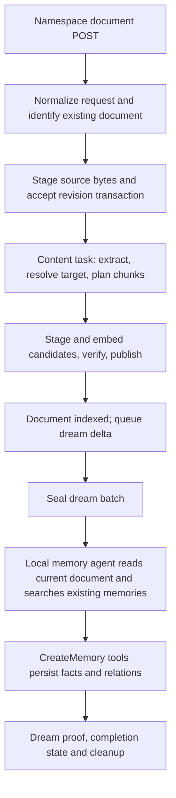

# Shipped local Supermemory: save orchestration

This traces the **local server JavaScript shipped in the inspected binary**. It
is static control/data-flow evidence, not an observed server run and not a claim
about the hosted proprietary models. No target binary or extracted target script
was executed. The visible local JavaScript is substantial; saying the entire
backend is unknown would now be inaccurate.

## Evidence identity and coordinates

Read-only inputs are the parent workspace's
[derived JavaScript](../../../supermemory-artifacts/derived-analysis/server-analysis.js),
[derivation manifest](../../../supermemory-artifacts/derived-analysis/derivation.json),
and [static symbol index](../../../supermemory-artifacts/derived-analysis/symbol-ranges.json).

- Binary SHA256: `b908080270df6d2eb5712637cb833ebd4fc99a6ee15771d38a555084961332e8`.
- Extracted original JavaScript SHA256: `95fdc8c78695db67bda4d91144d03169b2ee798bc3b70e94d0932f1668900516`.
- Inspected derived SHA256, independently rechecked: `89e5209960118a376bd1d4fe3914b966c9d41097010f3612deff02651c4aaf1f`.

The derivation omits long base64-shaped regions; it is not original source or a
runnable reconstruction. `L#:C#` below means one-based line and UTF-16 character
column in this exact derived file. `AST[start,end)` uses the static Babel index's
zero-based UTF-16 offsets. These are not binary offsets; the derivation manifest
must be used to reason about original byte locations.

## The reached local path

This is a call trace, not an assertion that all stages always run: duplicates,
metadata-only changes, existing manifests, stale generations, and failures take
explicit alternate branches.

## 1. API request → document identity → accepted revision

The namespace route `y08` validates params/query/body, applies `UU("add")`, requires
namespace write access, and dispatches `cW("add")`. `X75` maps public `id` to
internal `customId`; `yr` maps `supportingContext → entityContext`, `group →
filterByMetadata`, and `date → documentDate`. `Ou` registers the handler that
`cW` retrieves, so this reaches the shared add handler rather than an unrelated
bundled example. Evidence: `L1788:C53087` onward; `X75` at `L1788:C5687`,
`yr` at `C5545`, `Ou` at `C17172`, `cW` at `C17206`.

The shared handler `U08` calls `JU`, then `Z08`. `Z08`:

- trims string input, rejects custom IDs longer than 255 characters, and calls
  the extractor registry's `canExtract` before accepting work;
- resolves the validated namespace/container tags, verifies space write state,
  creates missing space records, and carries entity context/settings;
- merges explicit document date into metadata and stages source bytes before
  the database acceptance transaction;
- returns current duplicate status, a metadata-only result, or newly queued work.

Evidence: `Z08`, `L1779:C25051`, `AST[3834059,3844781)`; shared handler at
`L1788:C17513` onward. This route accepts work asynchronously; HTTP success is
not proof that facts have been generated.

### Document duplicate rules are specific

`i65` looks up **customId + organization**, then requires the exact ordered
container-tag array to match. A failed document is eligible for an update.
Equal sanitized content plus equal filtered metadata skips processing and returns
the document's current status. Equal content with changed metadata uses the
metadata-only path. Changed content takes the update path. Evidence:
`i65`, `L1779:C22027`, `AST[3831035,3831914)`; `T08`, `L1779:C21448`.

Without a custom ID/full replacement, `l65` compares SHA1 content hash within the
organization, then filtered metadata and tag membership (`NB0` sorts the tags).
This is **exact document-content identity**, not semantic fact deduplication.
Evidence: `l65`, `L1779:C21622`, `AST[3830630,3831034)`; SHA1 helper `zB0`,
`L1724:C14502`; `NB0`, `L1724:C27221`.

The identity constraint is also present in the schema:
`uq_document_identity(orgId, customId, containerTags)` for non-tombstoned custom
IDs, `L32:C12338` onward. The acceptance transaction retries that specific unique
constraint race once (`Z08`, `L1779:C34160`). This is not a complete
concurrency/soft-delete audit.

A bounded literal search of this derived file found no `Idempotency-Key`,
`idempotency-key`, or `idempotency_key`; its sole `idempotencyKey` occurrence is
usage billing. The demonstrated ingestion guarantee is document identity/content
handling, not a proven general HTTP idempotency-key facility.

### Durable acceptance is separate from execution

`KE8` stages inline/upload bytes with a digest and byte count; URLs retain a URL
source descriptor. `wL` finds the space, increments `latestRevision`, records an
accepted update, and creates a content task. If another content task for that
document is blocked/ready/running/retry-wait, the new task starts blocked.
Evidence: `KE8`, `L1724:C22800`, `AST[3672463,3672938)`; `wL`,
`L1724:C23980`, `AST[3673643,3674633)`; `mE8` at `L1724:C16384`.

When a document's content task finishes, `bB0` releases queued revisions in order;
a later full replacement cancels older blocked work preceding that replacement.
Evidence: `bB0`, `L1724:C16663`; `U55`, `L1779:C3506`.

## 2. Normalize and resolve content before chunking

`Q85` loads the accepted source, invokes the extractor registry, and normalizes
its content/title. A connector 401 can trigger one token refresh and re-extract.
The extraction result is checkpointed through `SS`; `lE8` verifies stored artifact
bytes against their digest when reading them. Evidence: `Q85`,
`L1774:C6755`, `AST[3790942,3791700)`; `g85`, `L1774:C7514`;
`SS`, `L1774:C3343`; `lE8`, `L1724:C20308`.

The visible string normalizers remove NUL/control characters on the duplicate
comparison path; extracted text normalization removes NUL and U+FFFD replacement
characters. They are not a semantic cleanup model. Evidence: `JJ8`,
`L316:C22578`; `Ed`, `L1774:C3824`; `YJ8`, `L316:C22529`; character constants at
`L316:C22691`.

`E85` resolves new content against the published document:

- replacement uses the new text;
- conversation-marked content uses `Y85` to find suffix/prefix overlap between
  delimiter-separated segments;
- an updated full transcript already beginning with existing content is used as
  supplied;
- otherwise the old and new text are appended with a separator.

`Y85` compares segments after normalizing image-description placeholders. Thus
conversation overlap, exact document duplicate detection, and later memory-fact
identity are three different operations. Evidence: `E85`, `L1774:C6506`,
`AST[3790693,3790841)`; `Y85`, `L1772:C67`, `AST[3783829,3784140)`;
`CT0`, `L1772:C3`; delimiter `ci`, `L1768:C182`.

## 3. Structural chunks, reuse, and publication

For this local build, the visible text chunker uses a default character limit of
**1075** (`kT = floor(1075.2)`) and overlap target **200** (`zA0`). Markdown-like
input is detected from headings/fences and structural cues. It groups sections,
keeps headings when splitting long sections, and falls back through text
boundaries/whitespace and ultimately fixed slices. This code does not itself
call an LLM to decide semantic chunk boundaries. Evidence: `H85`,
`L1766:C569`; `qA0`, `L1734:C22219`; `d85`, `L1764:C60`; `P85`,
`L1757:C142`; `HY`, `L1763:C600`; constants `kT`, `L32:C1701`, and `zA0`,
`L1766:C718`.

`V55` preserves all earlier chunks except the final chunk for a recognized append,
then re-chunks that tail plus the added text. `S85` reuses existing chunks by exact
content, including a queue for repeated identical chunks, and tracks changed
positions, additions, and removals. A namespace move disables vector reuse.
Evidence: `V55`, `L1774:C9262`, `AST[3793449,3794445)`; `S85`,
`L1766:C115`, `AST[3782554,3783008)`.

The content workflow `f$5` explicitly runs extract → resolve target → plan →
stage candidates → embed → verify → publish. Candidate IDs are deterministic
from update ID and position. Verification checks candidate count/content hashes
and the continued existence of reused active chunks. Publication checks task
ownership and the expected published base, atomically switches candidate rows
active, retires old rows, updates document content/hash, and records a publication
manifest. Existing manifest proof takes a resume path. Old vectors/chunks are
cleaned after publication. Evidence: `f$5`, `L2956:C105848`,
`AST[4330728,4332212)`; `m55`, `L1777:C1115`; `J55`,
`L1777:C14276`; `i55`, `L1777:C11282`; `c55`/`n55`, `L1779:C2945`/`C4234`.
The embedding/vector primitives are covered by the separate low-level report;
this trace establishes their ordering, not native vector-engine internals.

## 4. Document done → dream batch → local fact generation

After publication `h55` sets document `status=done`. A memory task with nonempty
content delta also queues a dream task. That is why indexed document completion
and completed memory extraction are separate states. Evidence: `i55`,
`L1777:C11282`; `h55`, `L1779:C2723`; `W55`, `L1777:C2457`.

Instant mode attempts to seal one update immediately. The visible dynamic batch
predicate becomes eligible at 10,000 queued tokens or 15 minutes of age; batch
assembly stops adding further members at 100 members, 20,000 accumulated tokens,
or 2 MiB. The first member is accepted before those aggregate checks, so the
token/byte thresholds are not a proven hard cap on a single large member.
It groups compatible settings digests and avoids overlapping dynamic work for
the same document. These are local scheduler constants, not guarantees about
actual latency. Evidence: `G55`, `L1779:C6343`; `wA0`, `L1779:C5234`;
`F55`, `L1779:C5298`; `St`, `L1779:C6622`; `M55`, `L1779:C8700`.

The reached batch function `g$5` checks
`services.memoryGeneration === "localAgent"` and calls `D$5`. The local configuration binding is independently visible as
`ez0="local"` → `yz0` → `fj8`, with embedded database, local-disk step data,
`memoryGeneration:"localAgent"`, and summaries disabled (`fj8`,
`AST[2300441,2300743)`). No default summary-generation stage is inferred. Nearby
`H$5/l$5/i$5` are **unavailable-lite stubs**, not recovered cloud extraction.
Evidence: `g$5`, `L2999:C13638`, `AST[4359984,4361714)`; stubs at
`L2956:C108399`.

`D$5` loops documents in the batch and calls `_$5`. The latter reads the first
space and the current document's active chunks: eight are initially inlined;
`readChunks` can fetch more. Although scheduling tracks deltas, this local agent
reads the **current whole document**, not only the new delta. It can search
existing memories and source chunks, inspect memory history, link/forget memories,
and call `CreateMemory`. The prompt asks it to search several specific topics
before writing and explicitly decide updates. The model chooses those actions;
this is not a deterministic semantic-dedup classifier. Evidence: `D$5`,
`L2999:C9084`, `AST[4355430,4356807)`; `_$5`, `L2956:C110045`,
`AST[4334925,4342918)`; `a$5`, `L2999:C597`; prompt `j$5`,
`AST[4342918,4346411)`.

The model call has a 40-step stopping condition, `maxRetries:2`, and
`maxOutputTokens:12000`. It writes through tools during the run rather than first
returning an all-or-nothing fact batch. `e$5` embeds and inserts each fact, filters
parents to the same organization/space, records relations/source document, and
makes updated parents non-latest. It compensates its own vector-upsert failure;
that is narrower than rolling back an entire multi-tool agent run. Evidence:
`_$5`, `L2956:C115084`; `e$5`, `L2999:C2592`,
`AST[4348932,4352080)`.

Only after all document agents succeed does `D$5` write its result artifact and
settle members. `w$5` marks `dreamingStatus=done`; `s$5` records batch result proof;
`L$5` finishes/closes the batch. If result proof exists on recovery, `g$5` rebuilds
vectors and completes without invoking the agent again. Evidence: `D$5`,
`L2999:C9084`; `w$5`, `L2999:C10462`; `s$5`, `L2999:C7107`;
`L$5`, `L2999:C7539`; resume branch `g$5`, `L2999:C13638`.

## 5. Retries and duplicate-fact limits

The task coordinator binds runtime IDs using flow version/generation, checks stale
or terminal tasks, and dispatches `createBatch` to the content/batch workflow
binding. Content and batch entry points fence stale ownership. Stage policies
are explicit: extraction and chunk embedding have retry limit 2 with 30-second
exponential delay and ten-minute timeout; local memory generation has retry
limit 3 with five-second exponential delay and thirty-minute timeout. These are
configuration fields, not measured attempt counts. Outer task failures can enter
retry-wait, with 5/15/30/60-minute backoff expressions and an exhaustion condition
of attempt+1 ≥ 3 or passed horizon. Evidence: `aA`, `L1779:C13980`; `w85`,
`L1774:C4631`; `E$5`, `L2999:C11095`; `N4`, `L2956:C107428`;
`W1`, `L2999:C16388`; `p55`/`yA0`/`mZ0`, `L1777:C7038`/`C8363`/`C8235`.

**Document idempotence does not establish fact idempotence.** Each visible `e$5`
call generates a fresh memory ID. No fact-text lookup or exact-evidence retry key
was found in that function. `_$5` initializes a fresh saved-memory array, but no
upfront deletion/resume-by-created-fact mechanism appears in its inspected body.
If a run creates facts and later fails, `D$5` has not yet recorded successful batch
proof; a retry may run the document agent again. This is a **static duplicate-risk
inference**, not a reproduced duplicate incident. The model's searches may avoid
some repeats, but they are not a storage uniqueness guarantee. Cloud behavior,
opaque runtime persistence details, and omitted payloads remain outside this
claim.

## Titan comparison: borrow the boundary, not the whole machinery

Current Titan already durably saves the scene before normal event extraction,
retries from that scene, validates extraction JSON, uses scene-derived memory IDs,
and has an exact-evidence retry key excluding fresh IDs/turns/embeddings while
preserving scene/event/provenance distinctions. See
[pipeline retry](../../app/save_pipeline/pipeline.py:799),
[save and scene IDs](../../app/save_pipeline/pipeline.py:131),
[normal event path](../../app/save_pipeline/pipeline.py:1929), and
[exact evidence identity](../../app/storage/memories.py:213).
These guarantees should be preserved; copying the local agent's fresh-ID writes
would not improve duplicate-save safety.

Titan's existing compiler prompt already requests self-contained subject/scope,
causality, source references, and explicit state. The worthwhile next diagnostic
is raw coherent scene → current compiler → public recall, with explicit pronoun,
reason/outcome, correction, wrong-project, and retry cases. If it loses context,
repair that narrow compiler-input/representation seam. Do not add another generic
instruction or a multi-search agent loop without a measured gain.

One concrete lifecycle difference deserves a focused check: Titan catches an
embedding failure and intentionally stores vectorless facts for keyword fallback;
Supermemory's visible chunk path refuses publication without verified candidates.
Test retry/visibility and report embedding readiness separately from durable fact
capture before deciding whether Titan needs a repair-status field. Do not simply
make successful fact capture fail because an embedding provider is unavailable.

The local agent's before-write history search is a testable option for **explicit
updates**, not evidence that broad semantic merging is safe. Any trial should
require same subject/attribute/environment, source-supported replacement, retained
history, no false production/lab conflict, and no duplicate facts after partial
failure. This investigation proposes no production implementation.
