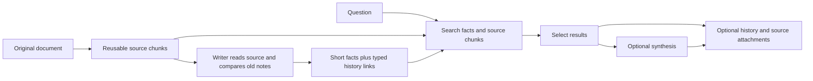

# What Supermemory teaches Titan

Investigated 2026-11-11. The strongest verified idea is to consult existing
memories while writing new ones, then distinguish a replacement from an addition.
Its adapters also prevent recalled context from feeding back into saving. Titan
now implements that second boundary on `reinventing-titan`.

This is static inspection of public source and a shipped local server, plus a
tested independent Titan change. It is not a reproduction of Supermemory's
hosted service or a claim that Titan now matches its quality.

## Deep pipeline trace

The follow-up traced the reached local routes, worker dispatch, storage helpers,
and response assembly. Its detailed reports are:

- [Save pipeline](supermemory-save-internals.md): document identity, accepted
  revisions, append/chunk reuse, publication, fact generation and recovery.
- [Retrieval pipeline](supermemory-retrieval-internals.md): actual route defaults,
  time filters, candidate lanes, selection, aggregation and history attachments.
- [Vector and embedding internals](supermemory-vector-internals.md): local SQL,
  model configuration, batching, normalization and focused REA evidence.
- [Correctness review](supermemory-correctness-review.md): source grounding,
  version semantics, scope boundaries and partial-failure risks.

The mechanism in plain language:

The writer is instructed to compare old memories; the tools do not enforce that
it searched before writing. History attachments happen after primary selection,
so this path does not establish graph-based ranking. The local build explicitly
selects `localAgent`; nearby unavailable hosted-generation stubs are not evidence
of cloud behavior.

| Stage | Actual local behavior | Titan decision |
| --- | --- | --- |
| Repeat document | Exact content/custom-ID handling; reused chunks avoid some re-embedding. | Keep clear identity and incremental work; Titan already has scene/event retry identity. |
| Changed fact | Model proposes a typed relation to old facts; storage keeps history. | Test a small explicit-correction resolver with source proof and retained history. |
| Ordinary v5 search | Defaults: hybrid, limit 10, threshold 0.3, rewriting off, rerank none. Searches facts and source chunks, normally requesting 3× candidates. | Do not mistake extra candidate machinery for a measured quality improvement. |
| Time question | Conservative parsing can filter event intervals; qualifying date-only memory requests skip embeddings. | Distinguish when an event happened from when Titan saved it. |
| Related history | Optional bounded links attached after ranking. | Useful once trustworthy links exist; charge every attached character. |
| Aggregate option | At limit 10, up to 30 selected inputs feed three model batches and possibly one consolidation call, before retries. | Separate synthesis from retrieval and require explicit source mapping. |

Limits matter: duplicate documents and duplicate facts are different problems.
The local fact writer can leave successful writes behind before a larger run
fails, and its retry path has no demonstrated deterministic per-fact identity.
Normalized-text retrieval dedup can collapse distinct punctuation/case and drops
the losing item's evidence. Generated aggregate summaries have synthetic IDs
without an explicit input-source mapping. These mechanisms should not replace
Titan's stronger evidence and retry boundaries.

Coverage checklist: local save route through completion **traced**; current v5
and legacy retrieval routes through response **traced**; key identity/version/
failure boundaries **statically reviewed**; artifact and selected source hashes
**verified**; hosted implementation, runtime behavior, quality and performance
**unverified**. No broader production algorithm was enabled during this deep
follow-up. The implemented change remains the tested feedback boundary below.

## The useful mechanisms

| Mechanism | Observed evidence | Decision for Titan |
| --- | --- | --- |
| Check existing notes before writing. | Local server `_$5` exposes memory search, document search, chunk reading and memory-history inspection to its extraction agent. | Worth a bounded correction experiment; not added to the live save path here. |
| Separate replacement, addition and inference. | Local `e$5` writes typed relations; only `updates` parents lose `isLatest`. Old records remain. | Prefer explicit, source-backed links over guessing from opposite words. |
| Keep read context separate from new evidence. | Public SDK strips its owned injected memory blocks before capture. | Implemented at Titan's tool-evidence projection boundary. |
| Preserve source and scope. | Local memory creation validates parent IDs against organization and space, and inserts a document-source join. | Keep Titan's existing scene and event lineage; don't weaken it to a document-only reference. |
| Make standalone facts. | Local extraction prompt requests atomic facts and resolved event dates. | Titan already requests scoped, self-contained facts. Repeating the instruction adds no demonstrated value. |

The local extraction agent is configured with a 40-step stop condition, two
retries, and a prompt asking for several searches before creation. Its prompt
also encourages high memory counts. These are costs and design choices, not
evidence of accuracy. We did not copy the agent loop or its volume incentives.

`e$5` performs relational insertion and parent-state changes in a database
transaction, then invokes the vector adapter separately, with compensating cleanup
on vector-write failure. Further tracing found that local adapter `sJ8` writes
the embedding column in the same PostgreSQL database. These are distinct database
operations, not two independently established local stores.
The model supplies the proposed relation. We did not find a deterministic
contradiction or source-span validator in this inspected path; that does not
establish absence elsewhere.

## The change actually made

Pi's default tool-result capture and Claude's optional full tool-I/O capture can
place Titan retrieval output into a later scene. Previously that output entered
the fact extractor as ordinary fresh tool evidence. A replay could therefore
save an old claim under a new scene ID, bypassing same-evidence duplicate checks.

[`pipeline.py`](../../app/save_pipeline/pipeline.py) now recognizes Titan-owned
memory-read tools by exact identity and, for the multiplexed `titan` tool, its
parsed action. Their successful results remain in the durable raw scene but are
excluded from extraction and citeable fresh-evidence references. Unknown tools,
other providers, writes, doctor results and user-authored corrections remain
available. Failed reads retain explicit compact diagnostics without forwarding
their recalled result payload. Mixed trace packets preserve separate read/write
calls and original evidence-label positions.

No new model calls, embeddings, dependencies or configuration switches were
added. This change is independently implemented; no server code or downloaded
artifact is included in Titan.

Regression probes use the event-first pipeline, a disposable SQLite store and a
scripted extractor that saves the target fact whenever it can see it. Both
adapter replay cases failed before the fix and pass afterward. This demonstrates
the input boundary, not the quality of a live extraction model. Assistant
paraphrases, unrelated copies of the same fact, and semantic deduplication remain
outside this fix.

Initial full-suite verification after the production change: **834 passed,
194 subtests passed, 3 skipped, 4 failed**. The four failures are the same
release-artifact allowlist failures reproduced on the frozen original baseline:
onboarding font/license/SVG assets are rejected by packaging. The suite is not
fully green. After adding the remaining edge-case regressions, the focused
feedback, scene, extraction-stream and retry suites passed **41 tests**, including
all **11 feedback tests**. `git diff --check` also passed. The full suite ran
before those seven additional test cases; production code did not change after
that run.

## Artifact and evidence ledger

Public repository inspection is documented separately in
[supermemory-public-mechanisms.md](supermemory-public-mechanisms.md), with pinned
source links. The official [self-hosting documentation](https://supermemory.ai/docs/self-hosting/overview)
points to the separately built server. We downloaded the macOS ARM64 artifact
from [release `server-v0.0.9`](https://github.com/supermemoryai/supermemory/releases/tag/server-v0.0.9)
and verified its SHA-256 against that release's manifest. Neither the binary nor
its installer was executed. No account credentials or private memories were sent.

Artifact: `supermemory-server-darwin-arm64`, 270,147,520 bytes.

SHA-256: `b908080270df6d2eb5712637cb833ebd4fc99a6ee15771d38a555084961332e8`.

REA verified the ARM64 Mach-O layout and the `__BUN` segment at offset 59,179,008,
size 208,666,624. A shell inspection extracted the valid UTF-8 embedded JavaScript
range `[59179048, 267839552)` from the original binary. This extraction is
shell-derived evidence, not a claim that REA reconstructed original source.

Raw JavaScript SHA-256:
`95fdc8c78695db67bda4d91144d03169b2ee798bc3b70e94d0932f1668900516`.

Ten long base64-shaped runs were replaced with inspection placeholders. The
derived text is 4,954,756 bytes; SHA-256:
`89e5209960118a376bd1d4fe3914b966c9d41097010f3612deff02651c4aaf1f`.
It is not a runnable reconstruction. The separate derivation manifest records
every omitted range and its hash. The omitted blobs were not analyzed.

Anchors in this exact derived file:

- Line 2956, `_$5`: extraction tools and model invocation.
- Line 2956, `j$5`: extraction workflow prompt; continues on following lines.
- Line 2999, `c$5`: history, relations and document-source lookup.
- Line 2999, `e$5`: scoped parent validation, relation insertion, latest-state
  change, source join and vector-update compensation.

REA Evidence IDs:

- Mach-O retained result: `ev_47099a9376cce3c1309704422d8c672650e44e5026433d5a7d7cf654ef47af6c`.
- Segment view: `ev_60240aad88826575930358d1ddb8bdc95aae064200a50fd824e7fa5757d52047`.
- JavaScript retained analysis: `ev_2369dc65b8e1318e3df88be3ccd9eb2a2d5acf4834351e2ad752e4b7462cbd50`.
- JavaScript summary: `ev_30db0cc839d933482c5f03418a9c4d97cee8075c66fbd6e077fff1527a3bae6c`.

The JavaScript semantic analysis was partial, bounded at 5,000 nodes and 3,000
unknowns. Named-function findings above were also inspected directly as bounded
text. Native providers for full decompilation were unavailable; no installation
or repair was attempted. Runtime behavior, opaque native components, hosted
learned models and search quality remain unverified. A zero unknown count in the
export envelope does not mean complete semantic coverage.

Local inspection artifacts live outside the Git checkout at
`../supermemory-artifacts/` relative to the repository root. This includes
`derived-analysis/derivation.json`, `derived-analysis/server-analysis.js`, and
`rea-evidence.json` (five exported evidence records). The REA target was closed
after export. These artifacts are for local investigation, not redistribution
as Titan source.

## Next experiment, kept separate

For an explicit correction, retrieve at most a few plausible old facts, inspect
their source and scope, and ask whether the new source explicitly replaces one.
Record a supersedes link only with current-scene evidence; ambiguity keeps both.
Different people, projects and environments must remain separate. Old notes are
comparison context, never new evidence. Preserve history rather than delete it.

Test raw scenes through the actual writer before enabling this: true correction,
compatible addition, repeated fact, wrong project, wrong person, production/lab,
historical comparison, ambiguous date, and retry. Measure false replacements,
complete retrieval, duplicate saves and added model cost. This investigation
supports testing that design; it does not justify enabling an untested relation
classifier or promising perfect memory.
