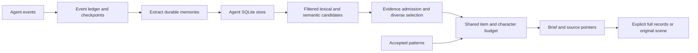

# Titan: useful continuity with bounded context

Investigation date: 2026-11-08. Six GPT-6.1 Terra workers investigated separate
surfaces, implemented fixes, and reviewed the combined result. The starting
checkout's existing retrieval, save and configuration changes were preserved.

## Finding

Titan already has the main pieces of a second brain: isolated agent stores,
durable memories, original scene evidence, cross-agent recall and accepted
patterns. The main problems were in deciding what reaches the agent and in
keeping that context traceable. A larger always-loaded memory prompt would
make these problems worse.

The implemented behavior is progressive disclosure: return a small relevant
brief and source-qualified pointers, then fetch full records or original
scenes only when the task needs them. Age, reliability, verification status and
fallback status stay available in compact pointers.

## Actual path

Source entry points:

- [Capture, scene lineage and combined recall](../../app/save_pipeline/pipeline.py)
- [Candidate filtering and ranking](../../app/retrieval_pipeline/retriever.py)
- [Read-only cross-agent recall](../../app/retrieval_pipeline/federated.py)
- [Memory notes and timelines](../../app/retrieval_pipeline/brief.py)
- [Pattern retrieval](../../app/patterns/retrieval.py)
- [MCP tools](../../entrypoints/mcp_server.py)
- [HTTP adapter](../../app/api/routes.py)
- [Claude automatic recall](../../integrations/claude_titan_plugin/runtime/daemon.py)

Complete Python sources were available, so the reverse-engineering skill's
source-repository route applied. No decompiler, target binary execution or REA
installation was necessary. Corpus inspection used SQLite read-only access.

## Implemented changes

| Problem observed | Resulting behavior |
| --- | --- |
| MCP search duplicated brief text as full records; recent queries bypassed compact limits | Search and recent queries default to compact output; `detail="full"` retains explicit record access. HTTP retains its existing full default and accepts compact explicitly. |
| All eighteen MCP tool descriptions reached clients that only needed everyday memory | Optional `TITAN_MCP_TOOL_PROFILE=core` exposes recall, save, original-scene lookup and doctor: four tools and 3,031 serialized tool-description characters versus 11,752 for the full inventory. The default profile remains full for compatibility. |
| Memory and pattern sections each consumed the whole budget | Both share the configured item and character budgets; zero budgets are honored. Defaults are six items and a 700-character brief, not a 700-character total JSON response. |
| One oversized hit blocked later useful memories | Oversized entries are skipped; smaller later evidence can fit. Briefs preserve the retriever's selected order. Cluster evidence and timelines obey limits too. |
| Compact evidence metadata could describe memories omitted by the brief | Pointers follow rendered hits. If nothing fits, bounded pointers remain available for inspection. Claude scene references follow its displayed records. |
| Cross-agent text deduplication erased alternate provenance | Exact-text duplicates retain up to ten source-qualified evidence pointers and an explicit overflow flag. They do not repeat full text or merge opposing statements. |
| Active-only records lacked source identity | Results receive the active namespace on copied records; source objects remain unchanged. |
| Legacy scene databases lacked newer evidence columns, silently hiding existing original scenes | Metadata lookup projects existing columns without schema migration. Older evidence is explicitly partial; missing scenes and failed lookups have distinct availability markers. |
| Whole-query similarity rejected a strong match to one part of a multi-part question | Admission considers the strongest requested facet before diversity selection. |
| Stored vectors from another model or invalid values could crash or poison ranking | Incompatible/nonfinite vectors are skipped; invalid query embeddings use keyword fallback. |
| Hidden metadata in a session blocked broader fallback | A hidden-only candidate set can retry without session bias. |
| An overlap heuristic suppressed factual memories about memory/search | Query-echo exclusion now requires evidence of a question or described search request before overlap can suppress a record. |
| Missing vectors triggered repeated corpus embedding on every query | Bundled `retrieval_selection.missing_embedding_mode: keyword` preserves word-based access without regenerating the vectorless corpus during recall. `embed` remains supported. |
| Attention tokenized candidate text repeatedly inside a pairwise loop | Each candidate's query-token overlap is computed once. A four-candidate fixture fell from twelve tokenizations to four, with identical attention matrices. |
| Immutable nested settings were treated as absent dictionaries | Pattern settings now recognize mappings, including runtime-frozen configuration. |
| Pattern lookup initialized stores and counted undisplayed guidance as shown | The brief uses read-only pattern lookup, skips lookup with no remaining budget, and records applications only for rendered patterns. Foreign-only source selection excludes active-agent patterns. |
| Empty automatic recall prompts fell back to recent memories | Claude skips empty/non-string prompts and omits blank or repeated evidence from the same source and scene. |

## Corpus considerations

Store inventories can identify duplicate candidates, missing vectors, and
unresolved scene references. These observations require separate investigation:
missing scenes are evidence gaps, and duplicate text alone is not a deletion plan.
Keep actual store inventories and their derived values private.

## Verification

The starting snapshot passed 651 tests, with three skipped and 132 subtests.
The final implementation passed **708 tests**, with three skipped and 143
subtests. Tests used an isolated home, temporary stores, deterministic provider
fixtures and a staged npm runtime. Initial attempts exposed host dependency and
sandbox-path assumptions; the final complete run resolved those test-environment
issues. `git diff --check` passed.

A read-only self-vector replay can serve as a sanity check, but it is not an
unseen-query relevance benchmark or evidence of live-provider latency. A
human-judged evaluation should measure answer usefulness, evidence, irrelevant
context, and appropriate abstention.

Focused regressions live in `tests/test_second_brain_*.py`,
`tests/test_brief_budget_context.py`, and the existing retrieval/federation/MCP
test files. 

## Limits and next useful improvements

- Vectorless records retain keyword access; semantic paraphrases need a
  separate embedding repair. Incompatible old-model vectors also need an
  explicit migration rather than hidden writeback during recall.
- Missing historical scenes cannot be reconstructed from a memory sentence.
  Recover original event evidence before treating a repaired reference as
  complete.
- Contradiction handling and query-echo detection remain heuristics. Accepted
  patterns and high similarity are evidence pointers, not proof of truth.
- No external extraction model, general live-provider latency improvement or
  passive capture in a fresh trusted agent session was validated.
- The next quality measurement should be a small human-judged set of real
  questions: useful answer, necessary evidence, irrelevant context and expected
  abstention. Optimize evidence usefulness per returned token, rather than
  increasing the amount injected by default.
